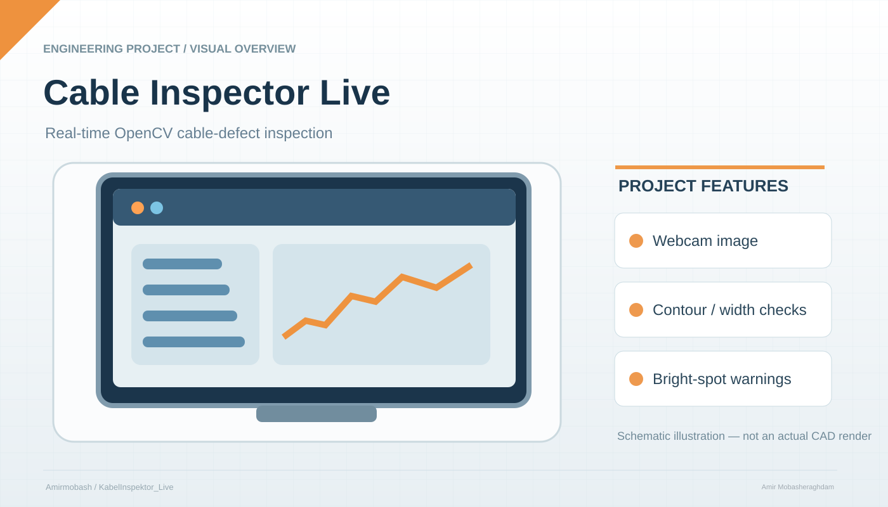

# KabelInspektor_Live


<p align="center"></p>

<sub>Illustrative project schematic; not an actual CAD export, hardware photograph, or independently tested result.</sub>


# KabelInspektor Live — Webcam-based Cable Defect Detection

**KabelInspektor Live** is a lightweight, offline-capable computer-vision tool (Python/OpenCV) for live inspection of cables and wires using a webcam.  
It performs contrast enhancement, edge/contour detection, width-profile analysis and bright-spot (exposed-metal) detection — all with a real-time GUI for tuning.

**Author:** Amir Mobasheraghdam — AI Specialist

---

## Quick links
- Demo script: `KabelInspektor_Live.py`
- License: MIT
- Platform: Windows / Linux (Webcam via OpenCV)

---

## Features
- Live video from webcam with real-time overlays
- CLAHE contrast enhancement
- Automatic selection and rotation of the main cable contour
- Width-profile analysis to detect thinning, bulges, or gaps
- Bright-spot detection for exposed metal or reflections
- Interactive Trackbars for tuning thresholds
- Snapshot and CSV logging

---

## Requirements

- Python 3.8+
- OpenCV
- NumPy

Install dependencies:
```bash
pip install opencv-python numpy
